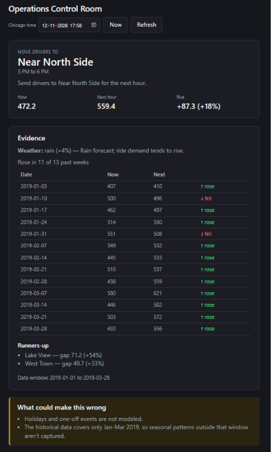

# Control Room

A ride-hail operations tool: tells an operator which Chicago community area to send
drivers to in the next hour, based on historical demand patterns and next-hour weather.

```
GET /api/recommendation
```

- **Backend**: Go, [Gin](https://github.com/gin-gonic/gin), SQLite (`modernc.org/sqlite`, pure Go, no CGO)
- **Frontend**: React + TypeScript (Vite)
- **Data**: Chicago's public Transportation Network Providers trip data, Jan 1 – Mar 29 2019
- **Weather**: [Open-Meteo](https://open-meteo.com/) forecast API

---

## Architecture overview

```
control_room/                 (repo root)
  backend/
    cmd/
      server/        entrypoint: HTTP API (+ serves the built frontend in production)
      migrate/        one-shot: create/update the sqlite schema
      ingest/          one-shot: load the two seed CSVs into sqlite
    internal/
      config/          env-var configuration
      store/           sqlite connection, migrations, community_areas repository
      weather/         Open-Meteo client + condition→multiplier classification
      recommendation/  the recommendation logic (baseline math, rules, evidence)
      api/             Gin handlers + router
      service/         thin service layer (community areas)
    data/              seed CSVs (community_areas.csv, trip_hourly.csv)
  frontend/
    src/               React app (App, RecommendationCard, EvidenceSection, CouldBeWrong)
  analysis/
    transportation_network_providers_data_analysis.ipynb   turns the raw city CSV into the seed CSVs above
  docs/
    frontend_screenshot.png
  Dockerfile           production image (single container, frontend + backend)
  docker-compose.yml   local development (two hot-reloading containers)
  entrypoint.sh         migrate + seed + start, used by the production image
```

**Request flow**: `GET /api/recommendation[?at=2006-01-02T15:04]` →
`internal/api.RecommendationHandler` parses `at` (or defaults to now) → `internal/recommendation.Build`
fetches the SQL baseline and the weather forecast **in parallel** (`errgroup`) → applies the
weather multiplier → picks a winner or holds → assembles the JSON response, including the
evidence that justifies it.

---

## Quick start (Docker Compose, recommended)

Brings up two containers with hot reload: the Go API (`go run`, recompiles on restart) and the
Vite dev server, source-mounted from the host.

```sh
docker compose up -d
docker compose exec backend go run ./cmd/ingest   # first time only: seed the database
```

- Frontend: http://localhost:5173
- Backend API: http://localhost:8080

Override the published ports if 8080/5173 are taken locally: `BACKEND_PORT=18080 FRONTEND_PORT=15173 docker compose up -d`.

To reseed later (e.g. after editing a CSV), just re-run the `ingest` command above — it's an
upsert, safe to run repeatedly.

## Production image

A single container serves the API **and** the built frontend (no compose needed):

```sh
docker build -t control-room .
docker run -p 8080:8080 -v control-room-data:/data control-room
```

On every start, the container runs `migrate` then `ingest` (both idempotent) against the seed
CSVs baked into the image, then execs the server. Open http://localhost:8080.

## Local development without Docker

Requires Go 1.26+ and Node 22+.

```sh
# backend
cd backend
go run ./cmd/migrate                 # create the schema
go run ./cmd/ingest                  # load the seed CSVs
go run ./cmd/server                  # http://localhost:8080

# frontend (separate terminal)
cd frontend
npm install
npm run dev                          # http://localhost:5173, proxies /api to :8080
```

---

## Configuration

All backend configuration is via environment variables (`internal/config/config.go`):

| Variable     | Default                     | Meaning                                                              |
|--------------|------------------------------|------------------------------------------------------------------------|
| `PORT`       | `8080`                       | HTTP port                                                               |
| `DB_PATH`    | `data/control_room.db`       | SQLite file path                                                        |
| `STATIC_DIR` | *(empty)*                    | If set, also serves the built frontend from this directory (production) |

The frontend's dev proxy target is configurable too: `VITE_API_PROXY_TARGET` (default
`http://localhost:8080`; the dev compose setup points it at `http://backend:8080`).

---

## Database design

Two tables (`internal/store/migrations/001_init.sql`):

```sql
CREATE TABLE IF NOT EXISTS community_areas (
    id   INTEGER PRIMARY KEY,
    name TEXT NOT NULL
);

CREATE TABLE IF NOT EXISTS trip_hourly (
    area_id    INTEGER NOT NULL REFERENCES community_areas(id),
    hour_start TEXT    NOT NULL,           -- 'YYYY-MM-DD HH:00' America/Chicago
    trips      INTEGER NOT NULL,
    fare_sum   REAL    NOT NULL DEFAULT 0,
    PRIMARY KEY (area_id, hour_start)
) WITHOUT ROWID;
```

### The baseline query (`internal/recommendation/baseline.go`)

The recommendation needs, per area, the average trips/hour for the *current* hour-of-week slot
and the *next* one (e.g. "Mondays at 5pm" and "Mondays at 6pm"). One query gets both, filtered to
just those two `(weekday, hour)` pairs instead of grouping the whole table:

```sql
SELECT area_id,
       CAST(strftime('%w', hour_start) AS INTEGER) AS wd,
       CAST(strftime('%H', hour_start) AS INTEGER) AS hr,
       SUM(trips) AS total
FROM trip_hourly
WHERE (strftime('%w', hour_start) = ? AND strftime('%H', hour_start) = ?)
   OR (strftime('%w', hour_start) = ? AND strftime('%H', hour_start) = ?)
GROUP BY area_id, wd, hr
```

### The past-weeks query (`internal/recommendation/evidence.go`)

For the winning area, the response's `past_weeks` evidence (did it actually rise, week over week,
historically?) needs the exact trip counts at every past occurrence of the slot, plus the hour
right after.

```sql
SELECT hour_start, trips FROM trip_hourly WHERE area_id = ? AND hour_start IN (?)
```

---

## API

### `GET /api/recommendation`

Optional query param: `?at=2006-01-02T15:04` (Chicago local time) overrides "now"; a malformed
value returns `400`. An empty database returns a `503` with a clear error message rather than a
zeroed-out recommendation.

<details>
<summary>Example response (click to expand)</summary>

```json
{
  "action": "move_drivers",
  "headline": "Send drivers to Lake View for the next hour.",
  "area": { "id": 6, "name": "Lake View" },
  "window": { "from": "5 PM", "to": "6 PM" },
  "expected": { "now": 113.3, "next": 146.7, "gap": 33.3, "ratio": 1.29 },
  "evidence": {
    "weather": { "available": false, "multiplier": 1 },
    "past_weeks": [
      { "date": "2019-01-07", "now": 97, "next": 116, "rose": true },
      { "date": "2019-01-14", "now": 117, "next": 142, "rose": true },
      { "date": "2019-03-18", "now": 121, "next": 118, "rose": false }
    ],
    "weeks_rose": "11 of 12",
    "runners_up": [
      { "name": "Lincoln Park", "gap": 19.9, "ratio": 1.2 },
      { "name": "West Town", "gap": 16.1, "ratio": 1.13 }
    ],
    "data_window": "2019-01-01 to 2019-03-29"
  },
  "could_be_wrong": [
    "Holidays and one-off events are not modeled.",
    "The historical data covers only Jan-Mar 2019, so seasonal patterns outside that window aren't captured.",
    "Next-hour weather forecast was unavailable; the demand multiplier was assumed neutral (1.0x)."
  ]
}
```

(`weather.available` is `false` here because this example used `?at=2019-02-04T17:20` — Open-Meteo
only forecasts a couple of days ahead, so a past date naturally gets no weather, by design; see
"Limitations" below.)

</details>

### `GET /community-areas`, `GET /healthz`

List of the 77 Chicago community areas, and a liveness check, respectively.

### Demo

```sh
$ curl -s "localhost:8080/api/recommendation?at=2019-02-04T17:20" | jq '.action, .headline, .expected'
"move_drivers"
"Send drivers to Lake View for the next hour."
{
  "now": 113.3,
  "next": 146.7,
  "gap": 33.3,
  "ratio": 1.29
}
```

The frontend (`frontend/`) renders this as a single-page dashboard: a recommendation
card (area, window, headline, Now/Next/Rise stats, or a neutral "Hold" card), an evidence section
(weather, a past-weeks table with a text rise/fall marker, runners-up, data window), and an
always-visible "What could make this wrong" panel — plus a date/time picker to replay any point
in the data (or beyond it) against the same live logic.



---

## Tests

```sh
cd backend && go test ./...
```

---

## Analysis notebook

`analysis/transportation_network_providers_data_analysis.ipynb` is where the seed data comes
from. It starts from Chicago's full public rideshare trips CSV (4.8M+ rows, 2018-2022) and:

- picks the usable window — 1 Jan to 29 Mar 2019 (full days only; the data gets sparse after that)
- maps community area numbers to names via the city's open data API
- groups trips into one row per (area, hour) —>`trip_hourly.csv`

Run it with `pip install -r analysis/requirements.txt` and open it in Jupyter. It needs the raw
city CSV, which isn't checked into this repo (it's a few GB) — the two small CSVs it produces
(`backend/data/community_areas.csv`, `backend/data/trip_hourly.csv`) already are, so you don't
need to re-run it just to run the app.

---

## Assumptions, trade-offs, and known limitations

**Of the recommendation itself** (surfaced live in every response's `could_be_wrong`, plus a few
only worth stating once, here):

- **Holidays and one-off events aren't modeled.** A slot's "normal" baseline is a plain historical
  average; it has no notion of New Year's Day or a Bears game.
- **The data is Jan–Mar 2019 only** (winter in Chicago). Patterns outside that window — summer
  demand, different weekday mixes, year-over-year growth — aren't captured.
- **Weather is a forecast, not an archive.** Open-Meteo only forecasts a couple of days ahead,
  so `?at=` values outside that window (including every past date in the 2019 trip data) get
  `weather.available: false` and a neutral 1.0x multiplier instead of an error
- Weather impact recommendation is added based on my own assumptions.

AI-use disclosure:
- Github Copilot used for the following usecases:
  - Getting auto-complete suggestions, commenting, ingest pipeline and UI css alignment, for example in ingest pipeline it suggested me in error handling
  - While writing sqlite.go it recommend me to use database/sql package, but I have used github.com/jmoiron/sqlx since it provides better flexibility in writing sql code.
  - Gemini used for writing document.

